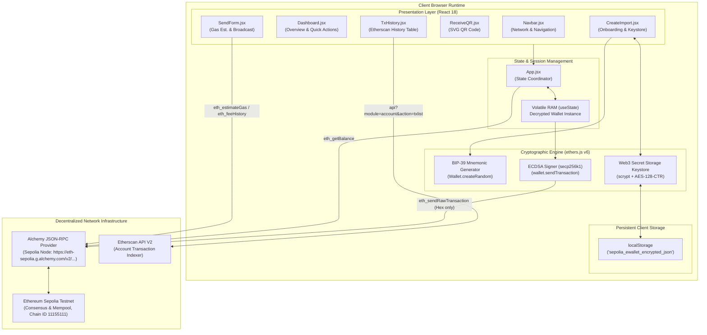
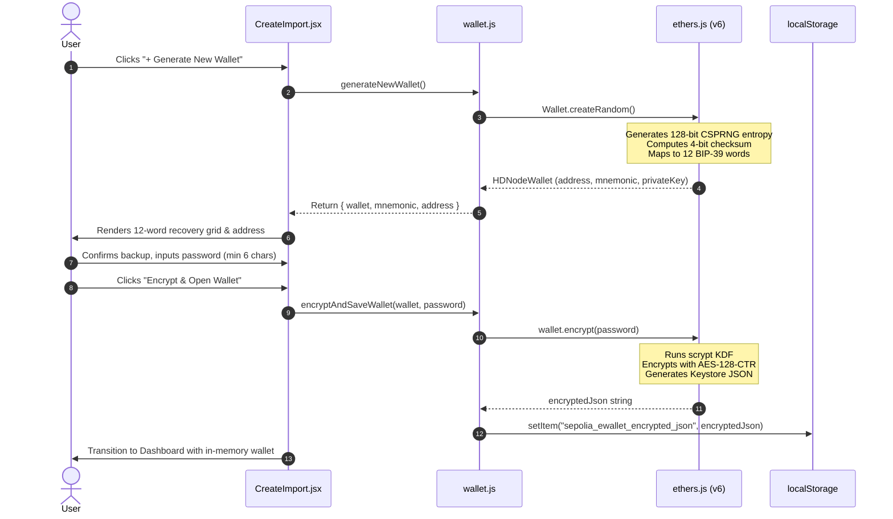
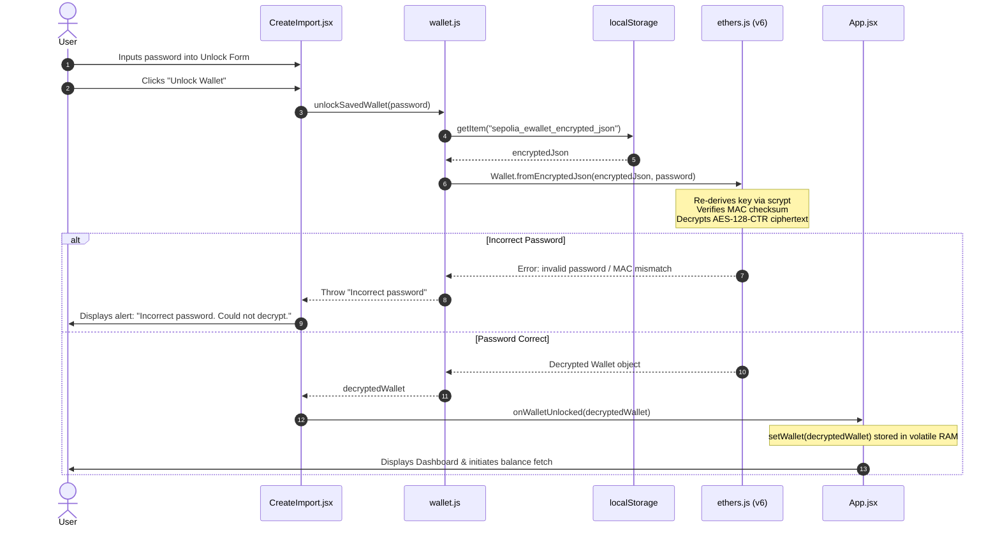
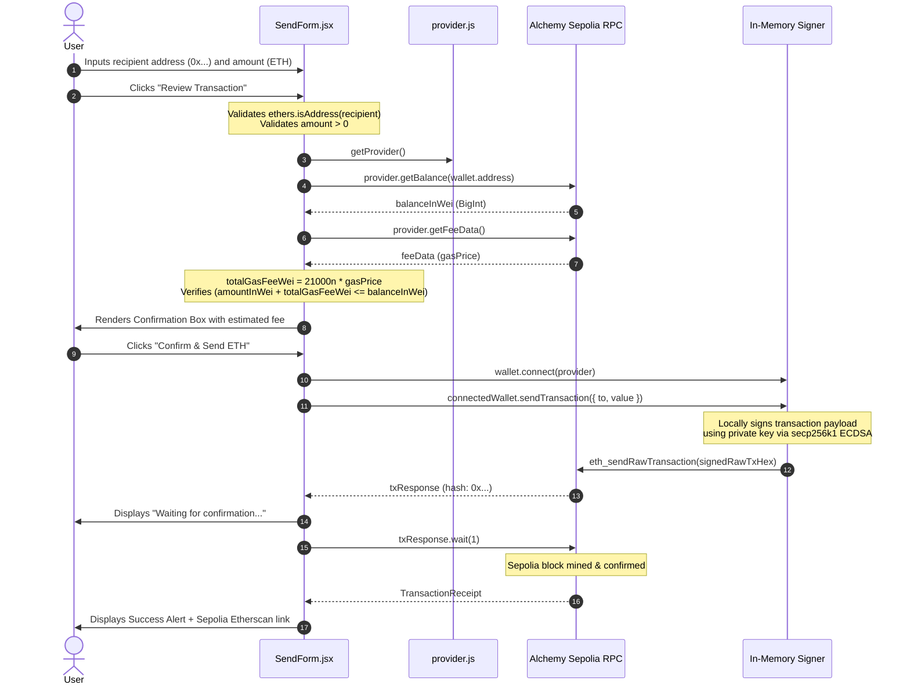

# System Architecture & Technical Specifications: SepoliaPay Vault

## 1. High-Level Architecture Diagram

SepoliaPay Vault enforces a strict **Zero-Custody, Client-Sovereign Architecture**. All cryptographic operations occur inside the browser runtime.



---

## 2. Layered Architecture Breakdown

### 2.1 Layer 1: Client Presentation Layer
- **Component Hierarchy**:
  - `App.jsx` (Root orchestrator)
    - `Navbar.jsx` (Header, Sepolia Network Badge, dynamic navigation)
    - `EducationalBanner` (Academic notice)
    - Conditional View Routing:
      - `CreateImport.jsx` (Unlocked === false)
      - `Dashboard.jsx` (Unlocked === true)
        - `WalletCard.jsx`
      - `Send.jsx`
        - `SendForm.jsx`
      - `Receive.jsx`
        - `ReceiveQR.jsx`
      - `History.jsx`
        - `TxHistory.jsx`
    - `Footer.jsx`

### 2.2 Layer 2: State & Volatile Session Management
- **In-Memory Volatility**: The decrypted `wallet` instance resides exclusively in `App.jsx` state (`useState(null)`).
- **Session Purging**: 
  - Clicking **Logout** executes `setWallet(null)` and resets balance state.
  - Page refresh or closing the tab destroys the volatile heap memory.
  - No session cookies, tokens, or plaintext values are ever written to browser storage.

### 2.3 Layer 3: Cryptographic Keystore Layer
- **Format**: Conforms to Ethereum Web3 Secret Storage Definition (v3).
- **Encryption Parameters**:
  - Key Derivation Function (KDF): `scrypt`
  - $N = 8192$, $r = 8$, $p = 1$, $dklen = 32$
  - Cipher: `aes-128-ctr`
  - MAC: $\text{Keccak-256}(\text{derivedKey}[16..32] \parallel \text{ciphertext})$
- **Persistence**: Encrypted ciphertext and cryptographic parameters are serialized to JSON string and saved under key `sepolia_ewallet_encrypted_json`.

### 2.4 Layer 4: Blockchain JSON-RPC Provider Layer
- Initialized via `new JsonRpcProvider(VITE_RPC_URL)`.
- Encapsulates:
  - `provider.getBalance(address)`: Queries current account state in integer Wei.
  - `provider.getFeeData()`: Retrieves base fee, priority fee, and recommended gas price.
  - `wallet.connect(provider)`: Binds the in-memory signer with the remote provider.
  - `connectedWallet.sendTransaction(txPayload)`: Signs locally and dispatches to Sepolia nodes.

### 2.5 Layer 5: Blockchain Explorer & Indexing Layer
- Direct REST query against Etherscan Sepolia V2 API:
  $$\text{URL} = \text{https://api.etherscan.io/v2/api?chainid=11155111\&module=account\&action=txlist\&address=0x...\&page=1\&offset=10\&sort=desc\&apikey=KEY}$$
- Avoids brute-force RPC block scanning by querying Etherscan's indexed SQL/Bigtable ledger.

---

## 3. Sequence Diagrams

### 3.1 Wallet Creation & Encryption Sequence



---

### 3.2 Wallet Decryption / Unlock Sequence



---

### 3.3 Transaction Preparation, Gas Estimation & Send Sequence



---

## 4. Security Boundaries

```
[ UNTRUSTED ZONE: Public Internet ]
           │
           ▼
[ ALCHEMY / ETHERSCAN PUBLIC APIS ]
  - Reads public balances
  - Receives signed tx hex only
  - No private key transmission
           │
═══════════╪═════════════════════════════════════════════════════
[ TRUST BOUNDARY: Local Web Browser Sandbox ]
           │
   ┌───────┴────────────────────────┐
   │ React Presentation Components  │
   │  (Dashboard, Send, Receive)    │
   └───────────────┬────────────────┘
                   │
   ┌───────────────▼────────────────┐
   │   Volatile Heap Memory (RAM)   │
   │  Decrypted wallet instance     │
   │  Zero persistence; auto-purge  │
   └───────────────┬────────────────┘
                   │ AES-128-CTR + scrypt
   ┌───────────────▼────────────────┐
   │      Browser localStorage      │
   │  Encrypted Keystore JSON only  │
   │  NO plain private keys or seed │
   └────────────────────────────────┘
```
