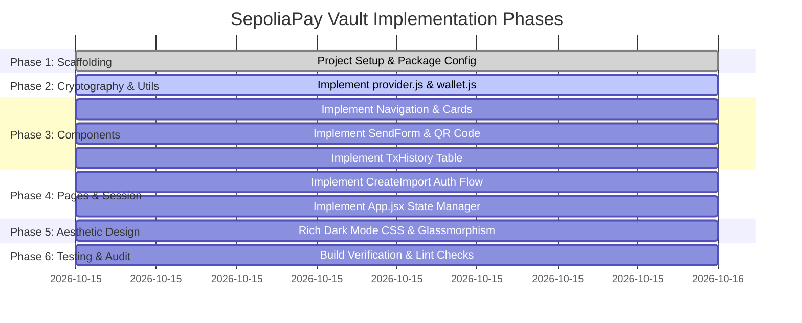

# Implementation Plan: SepoliaPay Vault

## 1. Executive Summary & Roadmap
This document outlines the systematic implementation strategy for **SepoliaPay Vault**, detailing each phase, deliverable, verification checklist, and testing protocol to ensure cryptographic accuracy and UI excellence.

---

## 2. Phased Implementation Roadmap

---

## 3. Phase-by-Phase Deliverables & Checklist

### Phase 1: Environment & Scaffolding
- [x] Create project documentation:
  - [x] [README.md](file:///d:/projects/EWallet/README.md)
  - [x] [PROJECT_OVERVIEW.md](file:///d:/projects/EWallet/PROJECT_OVERVIEW.md)
  - [x] [DESIGN_SYSTEM.md](file:///d:/projects/EWallet/DESIGN_SYSTEM.md)
  - [x] [ARCHITECTURE.md](file:///d:/projects/EWallet/ARCHITECTURE.md)
  - [x] [REQUIREMENTS.md](file:///d:/projects/EWallet/REQUIREMENTS.md)
  - [x] [IMPLEMENTATION_PLAN.md](file:///d:/projects/EWallet/IMPLEMENTATION_PLAN.md)
- [x] Initialize `package.json` with exact dependency versions:
  - `react: ^18.3.1`, `react-dom: ^18.3.1`
  - `ethers: 6.13.4`
  - `qrcode.react: 4.1.0`
  - `vite: ^5.4.11`, `@vitejs/plugin-react: ^4.3.4`
- [x] Create `vite.config.js` with React plugin.
- [x] Create `.env.example` and default `.env` template.
- [x] Create `index.html` with Google Fonts (Inter & JetBrains Mono) and favicon.

### Phase 2: Core Cryptographic Utilities
- [x] Create `src/utils/provider.js`:
  - `getProvider()`: Initializes `JsonRpcProvider(RPC_URL)` with environment variable validation.
  - `getEthBalance(address)`: Fetches integer Wei balance and formats into ETH string.
- [x] Create `src/utils/wallet.js`:
  - `generateNewWallet()`: BIP-39 mnemonic creation via `Wallet.createRandom()`.
  - `restoreWalletFromPhrase(phrase)`: Normalization, word count check, BIP-39 checksum verification via `Wallet.fromPhrase()`.
  - `encryptAndSaveWallet(wallet, password)`: AES-128-CTR + scrypt encryption saved to `localStorage`.
  - `unlockSavedWallet(password)`: Decryption via `Wallet.fromEncryptedJson()`.
  - `hasSavedWallet()` and `deleteSavedWallet()`: Storage management helpers.

### Phase 3: Component Engineering
- [x] Create `src/components/Navbar.jsx`:
  - Brand identity with `◈ SepoliaPay Vault` logo.
  - Network badge (`● Sepolia Testnet`).
  - Conditional navigation items (Dashboard, Send, Receive, History) and Logout button.
- [x] Create `src/components/WalletCard.jsx`:
  - Public address container with one-touch clipboard copy and tooltip confirmation.
  - Live ETH balance display with `↻ Refresh Balance` trigger and loading spinner.
  - Network badge and inline error handling.
- [x] Create `src/components/SendForm.jsx`:
  - Recipient address validation (`ethers.isAddress`) and amount checks.
  - Live gas fee estimation ($\text{gasPrice} \times 21,000$).
  - Pre-flight balance sufficiency validation.
  - Confirmation modal/box detailing recipient, fee, and total deduction.
  - Local transaction signing and broadcast (`connectedWallet.sendTransaction()`).
  - Single-block confirmation polling (`txResponse.wait(1)`) and Etherscan link generation.
- [x] Create `src/components/ReceiveQR.jsx`:
  - SVG QR code generation via `QRCodeSVG`.
  - Copyable address widget and testnet warning note.
- [x] Create `src/components/TxHistory.jsx`:
  - Etherscan API V2 client fetching last 10 transactions.
  - Hex address shortening utility (`0x1234...abcd`).
  - Table showing Tx Hash, From, To, Value (`+` incoming green, `-` outgoing red), and Timestamp.

### Phase 4: Page Wrappers & Root State Management
- [x] Create `src/pages/Dashboard.jsx`: Wraps `WalletCard` with quick action navigation buttons.
- [x] Create `src/pages/Send.jsx`: Wraps `SendForm`.
- [x] Create `src/pages/Receive.jsx`: Wraps `ReceiveQR`.
- [x] Create `src/pages/History.jsx`: Wraps `TxHistory`.
- [x] Create `src/pages/CreateImport.jsx`:
  - Multi-tab authentication container (Unlock Saved Wallet, Create New Wallet, Import Wallet).
  - 12-word recovery phrase grid and backup confirmation checkbox.
  - Password strength validation and confirmation matching.
  - Progress feedback during scrypt key derivation.
  - Keystore reset button for forgotten passwords.
- [x] Create `src/App.jsx`:
  - Root state holding decrypted `wallet` exclusively in React `useState`.
  - Automatic balance retrieval and refresh propagation.
  - Educational disclaimer notice.
  - View switcher and footer.
- [x] Create `src/main.jsx`: React 18 `createRoot` entry point.

### Phase 5: High-Aesthetic UI/UX Styling
- [x] Create `src/App.css`:
  - Clean, dark-mode CSS variables.
  - Glassmorphic card styling with backdrop filters and glowing borders.
  - Form controls with focus highlights.
  - Interactive buttons with micro-animations.
  - Mnemonic chip grid.
  - Responsive tables and spinner animations.

### Phase 6: Testing, Build Verification & Quality Assurance
- [x] Execute `npm install` to install dependencies.
- [x] Run `npm run build` to verify clean build without syntax or bundling errors.
- [x] Run development server and verify:
  - Wallet generation & mnemonic display.
  - LocalStorage keystore encryption check.
  - Decryption with password.
  - Navigation between views.
  - Responsive design on simulated mobile viewports.

---

## 4. Acceptance Criteria Checklist

| Feature | Acceptance Criteria | Verified |
|---|---|:---:|
| **Wallet Generation** | Generates 12 words, displays warning, disables encryption until confirmed. | ✅ |
| **Keystore Encryption** | Encrypts private key with scrypt + AES-128-CTR. No plaintext in `localStorage`. | ✅ |
| **Keystore Decryption** | Unlocks correctly with password; rejects wrong password with friendly error. | ✅ |
| **Volatile Session** | On logout or reload, in-memory wallet instance is destroyed. | ✅ |
| **Balance Display** | Displays live SepoliaETH balance or displays friendly error if RPC missing. | ✅ |
| **Send Form Gas Check** | Estimates 21,000 gas fee; validates address; blocks when balance is insufficient. | ✅ |
| **QR Code** | Valid SVG QR code generated with user's address. | ✅ |
| **Transaction History** | Fetches last 10 transactions via Etherscan API or shows informative message. | ✅ |
| **Build & Styling** | `npm run build` succeeds cleanly; UI adheres to modern dark fintech design system. | ✅ |
