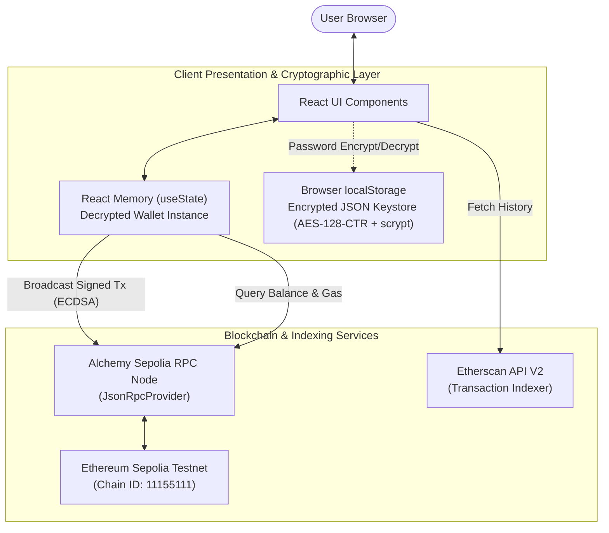

# SepoliaPay Vault — Non-Custodial Web3 E-Wallet

[-10b981?style=for-the-badge&logo=ethereum)](https://sepolia.etherscan.io)
[](https://docs.ethers.org/v6/)
[](https://react.dev)
[](https://vitejs.dev)

A modern, secure, browser-based **non-custodial cryptocurrency wallet** built for the **Ethereum Sepolia Testnet** using **React 18**, **Vite**, and **ethers.js v6**. 

SepoliaPay Vault demonstrates core blockchain and cryptographic engineering principles: local BIP-39 mnemonic generation, client-side AES-128-CTR + scrypt password keystore encryption (Web3 Secret Storage Definition), volatile RAM session management, JSON-RPC communication via Alchemy, live gas fee estimation, and transaction indexing via Etherscan API v2.

---

## 🌟 Key Features

- 🔐 **12-Word BIP-39 Recovery Phrase**: Deterministic cryptographic key generation using `ethers.Wallet.createRandom()`.
- 🛡️ **Web3 Secret Storage Encryption**: Encrypts private keys client-side using `scrypt` key derivation and `AES-128-CTR` (`wallet.encrypt(password)`).
- 🧠 **Zero Server Custody & In-Memory Decryption**: Decrypted private keys exist solely in transient React RAM (`useState`) and are purged on logout or page refresh.
- ⚡ **Alchemy JSON-RPC Integration**: Real-time balance queries and transaction broadcasting over HTTPS using `JsonRpcProvider`.
- ⛽ **Dynamic Gas Fee Estimation**: Live calculation of network gas prices (`provider.getFeeData()`) with standard 21,000 gas limit pre-flight balance checks.
- 📱 **QR Code Generation**: Instant address sharing via SVG QR codes (`qrcode.react`).
- 📜 **Etherscan V2 Transaction Explorer**: Real-time transaction history indexing for the last 10 incoming and outgoing transfers.
- 🎓 **Educational Guardrails**: Sepolia Testnet banner and safeguard alerts preventing mainnet confusion.

---

## 📐 Architecture Overview



---

## 🚀 Quick Start Guide

### Prerequisites
- **Node.js**: v18.x or v20.x (LTS recommended)
- **Alchemy Account**: For Sepolia RPC endpoint ([alchemy.com](https://www.alchemy.com/))
- **Etherscan Account**: For free Sepolia API key ([etherscan.io](https://etherscan.io/register))

### 1. Installation

```bash
# Clone or navigate to the repository
cd d:/projects/EWallet

# Install dependencies
npm install
```

### 2. Environment Configuration

Copy `.env.example` to `.env`:

```bash
cp .env.example .env
```

Edit `.env` and fill in your API credentials:

```ini
# Alchemy Sepolia RPC URL
VITE_RPC_URL=https://eth-sepolia.g.alchemy.com/v2/YOUR_ALCHEMY_API_KEY

# Etherscan API Key
VITE_ETHERSCAN_API_KEY=YOUR_ETHERSCAN_API_KEY
```

### 3. Launch Development Server

```bash
npm run dev
```

Visit `http://localhost:5173` in your browser.

---

## 🚰 Getting Free Sepolia Test ETH

To test sending and receiving transactions:
1. Launch the app and click **+ Generate New Wallet**.
2. Note your 12-word mnemonic, set a password, and unlock your wallet.
3. Copy your `0x...` public address from the Dashboard or Receive screen.
4. Request free Sepolia ETH from any of these faucets:
   - [Google Cloud Web3 Sepolia Faucet](https://cloud.google.com/application/web3/faucet/ethereum/sepolia) (0.05 SepoliaETH daily)
   - [PoW Sepolia Faucet](https://sepolia-faucet.pk910.de/) (Proof-of-work browser mining)
   - [Alchemy Sepolia Faucet](https://www.alchemy.com/faucets/ethereum-sepolia)

---

## 📁 Repository Structure

```
EWallet/
├── .env.example              # Environment variables template
├── index.html                # HTML entry point with Inter & JetBrains Mono typography
├── package.json              # Dependencies and build scripts
├── vite.config.js            # Vite configuration
├── README.md                 # Project overview and setup documentation
├── PROJECT_OVERVIEW.md       # Comprehensive system specification & report
├── DESIGN_SYSTEM.md          # UI/UX design tokens and CSS system
├── ARCHITECTURE.md           # Cryptographic and network flow architecture
├── REQUIREMENTS.md           # Functional & non-functional requirements
├── IMPLEMENTATION_PLAN.md    # Development phases & verification checklist
└── src/
    ├── App.jsx               # Root app component (state & session management)
    ├── App.css               # Modern dark-mode styling with glassmorphism
    ├── main.jsx              # React DOM mounting
    ├── components/
    │   ├── Navbar.jsx        # Top navigation with network badge
    │   ├── WalletCard.jsx    # Public address copy & live balance display
    │   ├── SendForm.jsx      # Gas estimation, address validation & broadcasting
    │   ├── ReceiveQR.jsx     # Scannable QR code generator
    │   └── TxHistory.jsx     # Etherscan v2 API transaction log
    ├── pages/
    │   ├── CreateImport.jsx  # Multi-mode onboarding (Unlock, Create, Import)
    │   ├── Dashboard.jsx     # Main wallet overview and quick actions
    │   ├── Send.jsx          # Send transaction view wrapper
    │   ├── Receive.jsx       # Receive test ETH view wrapper
    │   └── History.jsx       # Transaction history view wrapper
    └── utils/
        ├── provider.js       # Alchemy RPC connection & getBalance
        └── wallet.js         # BIP-39 mnemonic, AES-128-CTR & scrypt keystore
```

---

## 🎓 Academic Viva & Exam Q&A Reference

| # | Question | Short Technical Answer |
|---|---|---|
| **Q1** | *What is a non-custodial wallet?* | The user alone holds the private keys and 12-word mnemonic. No central server or database stores credentials. |
| **Q2** | *How is the 12-word phrase generated?* | Follows BIP-39: generates 128 bits of CSPRNG entropy, computes a 4-bit SHA-256 checksum, and maps the 132 bits into 12 words from the 2,048-word BIP-39 wordlist. |
| **Q3** | *Is localStorage secure for storing wallets?* | Raw keys in `localStorage` are vulnerable to XSS. We store an encrypted JSON Keystore generated by `wallet.encrypt()` via `scrypt` key derivation and `AES-128-CTR` encryption. |
| **Q4** | *Where does the decrypted private key live?* | Solely in volatile React memory (`useState`). It is completely erased upon logout or page refresh. |
| **Q5** | *Why do we need an Alchemy RPC provider?* | Web browsers cannot maintain a full Ethereum node. Alchemy forwards JSON-RPC calls over HTTPS to Sepolia nodes. |
| **Q6** | *Does Alchemy see the private key?* | No. Transactions are signed locally inside the browser using ECDSA (`secp256k1`), and only the signed raw transaction hex is broadcast. |
| **Q7** | *What is the difference between Wei and Ether?* | $1 \text{ ETH} = 10^{18} \text{ Wei}$. EVM executes math with integer Wei to prevent floating-point inaccuracies. |
| **Q8** | *How is the gas fee calculated?* | $\text{Fee} = 21,000 \times \text{gasPrice}$. Standard transfers take 21,000 gas units. |
| **Q9** | *Why use Etherscan API instead of RPC for history?* | Standard JSON-RPC nodes do not index transactions by address. Etherscan provides an indexed database for instant queries. |
| **Q10**| *What is Sepolia and its Chain ID?* | Sepolia is Ethereum's primary Proof-of-Stake testnet with Chain ID `11155111`. |

---

## ⚖️ License & Disclaimer

This project is released under the **MIT License**. It is strictly designed for **educational, academic, and research purposes**. It operates exclusively on the **Ethereum Sepolia Testnet**; testnet Ether has no real-world monetary value. Do not attempt to use mainnet assets or input production private keys.
